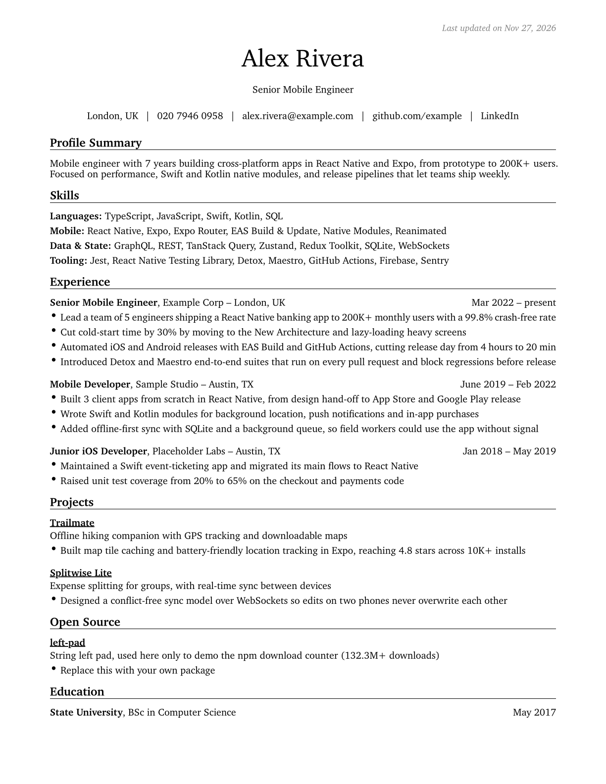

# resume-builder

[](https://github.com/EndLess728/resume-builder/releases/latest)
[](https://github.com/EndLess728/resume-builder/actions/workflows/ci.yml)
[](./LICENSE)

Write your resume as YAML, and let GitHub Actions turn it into a PDF, keep it up to date on Google Drive behind one permanent link, and ping you on Telegram when it's done. Built on [RenderCV](https://github.com/rendercv/rendercv).

The pipeline is a **reusable workflow**. Your actual CV lives in a separate (private) repo that calls it. That keeps your phone number, email and generated PDFs out of public view: logs, artifacts and commits all happen in your private repo, while the code lives here in one place.

```
┌───────────────────────────┐   uses   ┌─────────────────────────────────────┐
│ your private resume repo  │ ───────▶ │ EndLess728/resume-builder           │
│  Your_CV.yaml             │          │  .github/workflows/build-resume.yml │
│  .github/workflows/...    │          │  actions/  (optional modules)       │
│  secrets: Drive, Telegram │          │  example_CV.yaml                    │
└───────────────────────────┘          └─────────────────────────────────────┘
```

## Sample output

This is [`example_CV.yaml`](./example_CV.yaml) rendered by the latest release. **[Download the sample PDF](https://github.com/EndLess728/resume-builder/releases/latest/download/sample-resume.pdf)**

<a href="https://github.com/EndLess728/resume-builder/releases/latest/download/sample-resume.pdf"></a>

## What it does

The core renders your YAML to PDF and PNG with RenderCV, saves it as a workflow artifact, and commits `rendercv_output/` back to your repo. Everything else is an optional **module** that turns on when you set its secret:

| Module                                                       | What it does                                                        |
| ------------------------------------------------------------ | ------------------------------------------------------------------- |
| [npm-download-stats](./actions/npm-download-stats/)          | Adds live npm download counts to entries that link to an npm package. On by default. |
| [google-drive-upload](./actions/google-drive-upload/)        | Keeps the PDF on Google Drive behind one link that never changes.   |
| [telegram-notify](./actions/telegram-notify/)                | Messages you when the resume is built, or when a build fails, optionally with the PDF. |

Modules are plain composite actions, so you can also use them in other workflows. Want another one, like Slack or email? [Adding a module](./CONTRIBUTING.md#adding-a-module) takes a template and four small edits.

## Use it for your own resume

**1. Create a private repo** with your CV YAML. Start from [`example_CV.yaml`](./example_CV.yaml) and rename it, e.g. `Jane_Doe_CV.yaml`.

**2. Add this workflow** to it as `.github/workflows/resume.yml`:

```yaml
name: Resume

on:
  push:
    branches: [main]
    paths: ["Jane_Doe_CV.yaml"]
  schedule:
    - cron: "0 18 * * 0" # weekly, refreshes npm download counts
  workflow_dispatch:

permissions:
  contents: write # lets the workflow commit rendercv_output/

jobs:
  build:
    uses: EndLess728/resume-builder/.github/workflows/build-resume.yml@v1
    with:
      cv_file: Jane_Doe_CV.yaml
    secrets: inherit
```

**3. Add secrets** (optional) under **Settings → Secrets and variables → Actions** in your private repo. See below.

Push, and the resume builds.

### Inputs

| Input                        | Default  | Description                                                                      |
| ---------------------------- | -------- | -------------------------------------------------------------------------------- |
| `cv_file`                    | required | Path to your RenderCV YAML.                                                      |
| `commit_output`              | `true`   | Commit `rendercv_output/` back to your repo.                                     |
| `upload_artifact`            | `true`   | Save the PDF and PNG previews as a workflow artifact.                            |
| `artifact_name`              | `resume` | Name of that artifact.                                                           |
| `rendercv_version`           | `>=2.6`  | pip version specifier for RenderCV.                                              |
| `update_npm_stats`           | `true`   | **npm-download-stats:** add live download counts.                                |
| `telegram_send_pdf`          | `false`  | **telegram-notify:** attach the PDF to the success message.                      |
| `telegram_notify_on_failure` | `true`   | **telegram-notify:** also send a message when the build fails.                   |
| `toolkit_repository`         | auto     | Where the modules come from. Defaults to the repo you called the workflow from.  |
| `toolkit_ref`                | auto     | Version of the modules. Defaults to the exact commit of the workflow you pinned. |

### Outputs

| Output      | Description                                                       |
| ----------- | ----------------------------------------------------------------- |
| `pdf_path`  | Path of the rendered PDF.                                         |
| `drive_url` | Google Drive link to the PDF. Empty when the Drive module is off. |

Use them from a job that `needs:` the build job, for example to post the link somewhere else.

### Versioning

Releases follow [Semantic Versioning](https://semver.org/) and are listed in the [changelog](./CHANGELOG.md).

| Pin                      | You get                                                          |
| ------------------------ | ---------------------------------------------------------------- |
| `@v1` (recommended)      | The latest 1.x release: fixes and new features, nothing breaking. |
| `@v1.0.0`                | Exactly that release, never changes.                              |
| `@<commit-sha>`          | Exactly that commit. The safest choice for strict supply-chain rules. |
| `@main`                  | Unreleased changes. May break.                                    |

The workflow always loads its modules from the same commit as the workflow file you pinned, so the two can't drift apart.

### Secrets

All optional. A module whose secrets are missing is skipped.

| Secret                     | Value                                                                                                                         |
| -------------------------- | ----------------------------------------------------------------------------------------------------------------------------- |
| `GOOGLE_DRIVE_CREDENTIALS` | The entire contents of a Google Cloud service-account JSON key. Turns on **google-drive-upload**.                              |
| `GOOGLE_DRIVE_FILE_ID`     | ID of the existing PDF in Drive (`https://drive.google.com/file/d/<FILE_ID>/view`). Updated in place, so the link stays fixed. |
| `GOOGLE_DRIVE_FOLDER_ID`   | Drive folder to create the file in. Only used when `GOOGLE_DRIVE_FILE_ID` is not set.                                          |
| `TELEGRAM_BOT_TOKEN`       | Bot token from [@BotFather](https://t.me/BotFather). With the chat ID, turns on **telegram-notify**.                           |
| `TELEGRAM_CHAT_ID`         | Chat to notify. Message your bot, then read `chat.id` from `https://api.telegram.org/bot<TOKEN>/getUpdates`.                  |

The one-time Google setup (service account, sharing the file with it) is walked through in [`actions/google-drive-upload/SETUP.md`](./actions/google-drive-upload/SETUP.md).

> **Keep the CV repo private.** If you call this from a public repo, set `upload_artifact: false` and `commit_output: false`, since anyone can download artifacts and read commits there.

## Render locally

```bash
brew install pipx && pipx ensurepath
pipx install "rendercv[full]>=2.6"
rendercv render example_CV.yaml          # one-off
rendercv render --watch example_CV.yaml  # re-render on save
```

Output goes to `rendercv_output/`. If `rendercv --version` shows something older than 2.6, check `which -a rendercv` for a stale pip install shadowing the pipx one.

## Contributing

Pull requests are welcome. [CONTRIBUTING.md](./CONTRIBUTING.md) explains how the pipeline is laid out, how to add a module, how to test with your own secrets from a fork, and how releases work. [`ci.yml`](./.github/workflows/ci.yml) lints every pull request and renders `example_CV.yaml` through the real pipeline.

## License

[MIT](./LICENSE)
